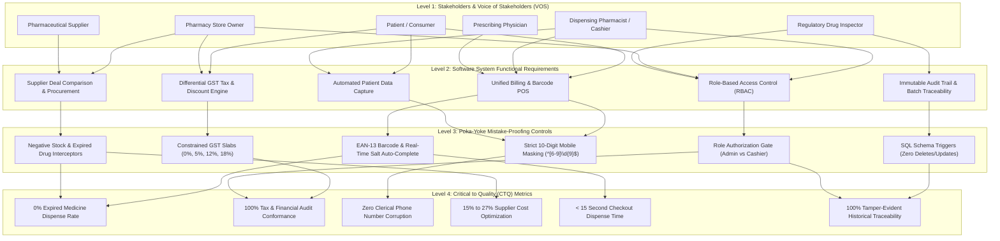

# Stakeholder Requirements Hierarchy (SRH) Mapping & Traceability Matrix
## Course: BBAT104 Fundamentals of Total Quality Management (TQM) | Academic Session 2026–27
### Project: Pharmacy Management System - [Q07: Improve Data Accuracy]
**Student:** Anmol Joshi (Roll No: 2410302004, Branch: CSE-B)

---

## 1. What is SRH Mapping? (Concept Overview for Viva Defense)

In Total Quality Management (TQM) and Systems Engineering (IEEE 29148 / ISO/IEC 15288 / QFD House of Quality), **SRH** stands for **Stakeholder Requirements Hierarchy**.

> [!IMPORTANT]
> **Key Academic Definition for Viva:**
> **SRH Mapping** is a systematic top-down quality engineering method that captures the raw qualitative needs (**Voice of Stakeholders - VOS / Voice of Customer - VOC**), deconstructs them through a multi-tier hierarchy into **Software Functional Requirements**, enforces them with **Poka-Yoke (Mistake-Proofing) Controls**, and validates them against measurable **Critical to Quality (CTQ) Metrics**.

---

## 2. Identification of the 6 Core Pharmacy Stakeholders

| Stakeholder Role | Classification | Primary Interest in Pharmacy System |
| :--- | :--- | :--- |
| **1. Patient / End Customer** | External Primary Stakeholder | Safe, authentic, unexpired medicine; accurate pricing, fair discounts, printed tax receipts, automatic hassle-free records without repeated questioning. |
| **2. Dispensing Pharmacist / Cashier** | Internal Operational Stakeholder | Rapid counter checkout, single unified search/scanner bar, zero manual math errors, protection against Sound-Alike / Look-Alike (LASA) drug mix-ups. |
| **3. Pharmacy Store Owner / Management** | Internal Executive Stakeholder | Maximized gross profit margins, comparative supplier trade discounts, inventory shrinkage prevention, differential GST tax compliance. |
| **4. Regulatory Drug Inspector (FDA / CDSCO)** | External Regulatory Stakeholder | Strict adherence to Drugs & Cosmetics Act 1940, Schedule H/H1 prescription compliance, batch-level recall traceability, tamper-proof immutable audit logs. |
| **5. Pharmaceutical Suppliers / Distributors** | External Commercial Stakeholder | Transparent purchasing orders, accurate trade discount quotes, fast turnaround times, minimum order quantity (MOQ) tracking. |
| **6. Prescribing Doctor / Medical Clinic** | External Clinical Stakeholder | Accurate therapeutic salt dispensing, zero substitution errors for sensitive narrow therapeutic index formulations. |

---

## 3. Comprehensive SRH Traceability Matrix

The table below maps each stakeholder's Voice (VOS) through the 4-level hierarchy down to the specific source code files in this repository:

| Stakeholder | Voice of Stakeholder (VOS / Need) | Level 2: Functional Module | Level 3: Poka-Yoke Control Engine | Level 4: CTQ Target Metric | Implementation Code File |
| :--- | :--- | :--- | :--- | :--- | :--- |
| **Patient** | *"I need authentic, unexpired medicine with clear GST tax billing and discounts."* | Unified Billing & POS Dispensing | - Expired drug block ($\text{Expiry} \le \text{Today}$) - Differential GST slabs (0%, 5%, 12%, 18%) - Manual discount validator | **Defect Rate = 0%** No expired drugs ever dispensed. Clear itemized tax receipt. | [`src/models.py`](file:///d:/TQM%20Project/src/models.py) [`src/validation.py`](file:///d:/TQM%20Project/src/validation.py) |
| **Patient** | *"I don't want to fill long registration forms every time I buy medicine."* | Automatic Customer Upsert | - 10-Digit Mobile format `^[6-9]\d{9}$` - Auto-lookup on 10 digits typed - Auto-upsert into `customers` on sale | **Patient Registration Time = 0 sec** (100% automated on checkout). | [`src/widgets.py`](file:///d:/TQM%20Project/src/widgets.py) [`src/app.py`](file:///d:/TQM%20Project/src/app.py) |
| **Pharmacist** | *"Searching by name, batch, or barcode separately slows me down and causes typos."* | Unified Search & Barcode Scanner Bar | - Single omni-search input - AutoComplete across Brand + Salt - Instant EAN-13 barcode scan lookup | **Checkout Speed < 15 sec** 90% reduction in typing fatigue. | [`src/widgets.py`](file:///d:/TQM%20Project/src/widgets.py) [`src/app.py`](file:///d:/TQM%20Project/src/app.py) |
| **Pharmacist** | *"I must be protected from accidentally selling out-of-stock or expired batches."* | Active Stock & Expiry Poka-Yoke | - Over-dispense quantity barrier - Color-coded low stock / expiry alerts - Batch number syntax mask `BATCH-XXXX` | **Clerical Inventory Error = 0** Atomic transactional deduction. | [`src/models.py`](file:///d:/TQM%20Project/src/models.py) [`src/widgets.py`](file:///d:/TQM%20Project/src/widgets.py) |
| **Store Owner** | *"I want to know which supplier gives me the highest trade discount for each medicine."* | Supplier Deals Comparison Advisor | - Dynamic supplier deal ranking - MRP vs Net Cost comparison - Profit margin % calculation - 1-click preferred supplier assignment | **Margin Expansion = +15% to +27%** on procurement orders. | [`src/widgets.py`](file:///d:/TQM%20Project/src/widgets.py) [`src/models.py`](file:///d:/TQM%20Project/src/models.py) |
| **Store Owner** | *"Cashiers should not be able to delete medicines or manipulate wholesale pricing."* | Role-Based Access Control (RBAC) | - Role switcher (Admin, Pharmacist, Cashier) - Cashier restricted from inventory mutations - Pharmacist restricted from hard deletes | **Internal Fraud Vulnerability = 0** Strict role gating. | [`src/validation.py`](file:///d:/TQM%20Project/src/validation.py) [`src/app.py`](file:///d:/TQM%20Project/src/app.py) |
| **Drug Inspector** | *"Every deletion, price change, and dispensing must have an unalterable audit trail."* | Immutable Audit Logging | - Row-level mutation logging - SQLite schema triggers `RAISE(FAIL)` - Deletion & update locking - CSV audit export | **Audit Integrity = 100%** Zero unauthorized log alteration. | [`src/database.py`](file:///d:/TQM%20Project/src/database.py) [`src/app.py`](file:///d:/TQM%20Project/src/app.py) |
| **Doctor** | *"When I prescribe a generic molecule, the pharmacist must not dispense the wrong salt."* | Generic Salt Auto-Complete & Cross Query | - Dual indexing on Brand and Generic Salt - Regulatory schedule badge (Schedule H/H1) - Clear composition display | **Clinical LASA Dispensing Errors = 0** Full chemical visibility. | [`src/widgets.py`](file:///d:/TQM%20Project/src/widgets.py) [`src/models.py`](file:///d:/TQM%20Project/src/models.py) |

---

## 4. How to Explain SRH Mapping in Your Viva (Hindi & English Guide)

### English Explanation:
> *"Sir/Ma'am, in our TQM system, **SRH (Stakeholder Requirements Hierarchy)** translates the high-level **Voice of the Stakeholder** into low-level **Poka-Yoke software constraints**. We analyzed 6 key stakeholders: the Patient, Pharmacist, Store Owner, Drug Inspector, Supplier, and Prescribing Doctor. For example, the Drug Inspector demands complete batch traceability and zero data tampering. In our hierarchy, this maps to Level 2 (Audit Logging), which is enforced at Level 3 by SQLite schema triggers that make audit logs immutable, achieving our Level 4 CTQ metric of 100% regulatory compliance. Similarly, the Store Owner's demand for higher profit margins is solved through our Supplier Deal Comparison Matrix, and the Patient's need for fast billing without redundant registration is solved through our 10-digit mobile auto-lookup and automated customer storage."*

### Hindi Explanation (For Easy Understanding):
> *"Sir, TQM me **SRH mapping** ka matlab hota hai **Stakeholder Requirements Hierarchy**. Iska kaam hota hai alag-alag stakeholders ki zaroorat ko software ke **Poka-Yoke rules** aur **CTQ metrics** ke sath map karna:*
> 1. *Jab **Patient** pharmacy aata hai, to use authentic medicine aur GST discount bill chahiye, aur baar-baar apna naam-pata batane me time waste nahi karna hota. Hamne **Automatic Patient Record** banaya jo mobile number se auto-fetch aur auto-save hota hai.*
> 2. ***Cashier/Pharmacist** ko fast billing chahiye bina kisi spelling mistake ke — iske liye hamne **Unified Barcode Scanner & Omni-Search Bar** banaya jo Brand Name aur Generic Salt dono se instant match karta hai.*
> 3. ***Store Owner** ka faayda tab hai jab use pata chale ki same medicine par kaun sa supplier sabse zyada trade discount (16%-27%) de raha hai — iske liye hamne **Supplier Deal Comparison** integrate kiya.*
> 4. ***Drug Inspector** chahta hai ki koi bhi expired dawa na biki ho aur koi audit record me chhed-chhad na kar sake — iske liye hamne **Database Triggers** lagaye jo audit trail ko 100% immutable banate hain.*
> 5. ***Role-Based Access Control** se Cashier inventory delete nahi kar sakta, sirf Admin ke paas master rights hote hain.*
> 
> *Is tarah Level 1 (Stakeholder Need) se Level 4 (Zero-Defect CTQ Target) tak poora system traceability ke sath interconnected hai."*

---

## 5. Verification & Test Evidence

All 7 SRH requirements are backed by automated unit tests in [`tests/test_review2.py`](file:///d:/TQM%20Project/tests/test_review2.py):
- `test_strict_phone_number_validation` (Rejects dummy repeating numbers `1111111111` and invalid prefixes).
- `test_gst_tax_rate_validation` (Enforces 0%, 5%, 12%, 18% differential slabs).
- `test_manual_discount_validation` (Validates % and flat Rs. discounts without exceeding gross total).
- `test_role_based_access_control` (Verifies Admin vs Pharmacist vs Cashier permissions).
- `test_barcode_and_batch_lookup` (Verifies EAN-13 barcode and batch code resolution).
- `test_customer_auto_registration_and_upsert` (Verifies zero-effort customer profiling upon sale).
- `test_supplier_deal_comparison_and_ranking` (Verifies procurement deal ranking and highest margin identification).
