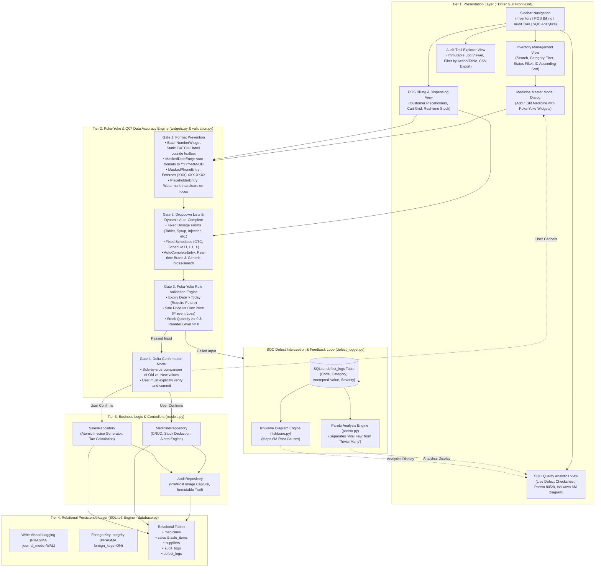
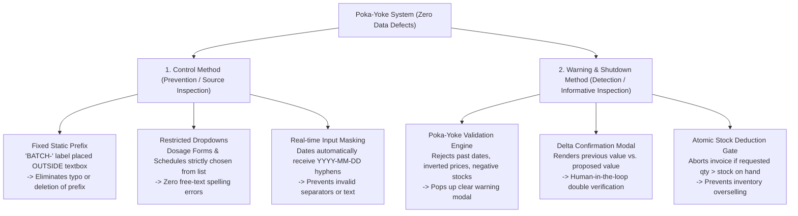
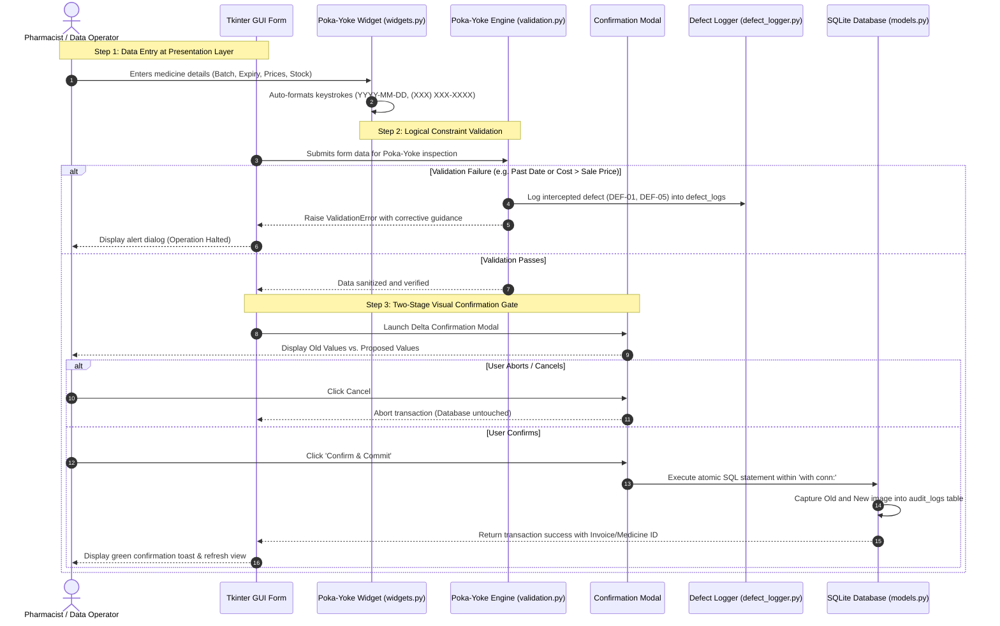

# System Architecture & Poka-Yoke Mistake-Proofing Model
## Pharmacy Management System — [Q07: Improve Data Accuracy]
### Course: BBAT104 — Fundamentals of Total Quality Management (TQM) | Session: 2026–27
**Author:** Anmol Joshi (Roll No: `2410302004`, Branch: CSE-B)  
**Allotted Quality Goal:** **Q07 — Improve Data Accuracy**

---

## 1. Executive Summary & Architectural Overview

In a healthcare environment, pharmaceutical inventory errors (such as mistyped batch numbers, corrupted expiry dates, selling wrong dosages, or out-of-stock dispensing) carry severe patient safety and regulatory liabilities.

This software architecture adheres strictly to **W. Edwards Deming's 3rd Quality Principle**:
> *"Cease dependence on inspection to achieve quality. Eliminate the need for inspection on a mass basis by building quality into the product in the first place."*

To accomplish this, our system is engineered using a **Layered Architecture with a Multi-Gate Poka-Yoke (Mistake-Proofing) Engine**. Every piece of data entered by a pharmacist must pass through **four sequential defense gates** before it is permanently stored in the SQLite database:

1. **Gate 1 (Ergonomic UI Prevention):** Traps keystrokes and restricts input formats directly at the widget layer.
2. **Gate 2 (Logic & Range Validation):** Enforces pharmaceutical business rules (e.g. expiry must be strictly in the future, selling price cannot be below purchase cost).
3. **Gate 3 (Two-Stage Confirmation Gate):** Renders a visual delta preview (Old Value vs. Proposed Value) before destructive edits or checkout.
4. **Gate 4 (Atomic Persistence & Audit Trail):** Executes an atomic database transaction while recording an immutable before-and-after audit snapshot.

Any validation failure intercepted at any gate is automatically directed to the **SQC Defect Logger**, providing empirical defect frequency data for **Pareto Analysis (80/20 Rule)** and **Ishikawa (Fishbone) Root Cause Analysis**.

---

## 2. Complete System Architecture Flowchart

The following diagram illustrates how user actions flow through the four architectural layers:



---

## 3. The Poka-Yoke (ポカヨケ) Mistake-Proofing Model Explained

### 3.1 What is Poka-Yoke?
**Poka-Yoke** (pronounced *POH-kah YOH-kay*) was developed by industrial engineer **Dr. Shigeo Shingo** as part of the Toyota Production System (TPS). The term translates to **"Mistake Proofing"** or **"Inadvertent Error Avoidance"** (*Poka* = inadvertent mistake; *Yoke* = prevent).

> [!IMPORTANT]
> **Core Quality Axiom:**  
> Human beings inherently make mistakes due to fatigue, distraction, cognitive overload, or pressure. Traditional inspection relies on catching mistakes *after* they happen (which fails ~20% of the time).  
> **Poka-Yoke designs the process such that human errors are physically or digitally impossible to commit, or are caught instantly at the source before any damage can occur.**

---

### 3.2 The Two Primary Methods of Poka-Yoke

Our pharmacy system employs both foundational methods defined in quality engineering:



1. **Control Method (Prevention):**
   - The system **blocks** the user from taking an erroneous action entirely.
   - *Example:* The word `"BATCH-"` is a fixed, read-only label positioned outside the input textbox. The user cannot delete it, backspace over it, or misspell it. The input box only accepts uppercase alphanumeric characters.
   - *Example:* Instead of allowing the user to type dosage forms like `"tab"`, `"tablet"`, or `"tablett"`, a locked dropdown forces a selection from verified medical categories.

2. **Warning & Shutdown Method (Detection & Gatekeeping):**
   - If an illogical value is entered, the system **halts execution**, alerts the operator with a descriptive visual dialog, and logs the defect event.
   - *Example:* If an operator enters an expiry date that has already passed, the system stops the transaction: *"Expired Batch Entry: Date 2024-05-10 has already passed. Drug cannot be registered."*
   - *Example:* Before updating wholesale prices or deleting inventory records, a **Delta Confirmation Modal** forces the user to review the exact modification side-by-side before committing.

---

## 4. Step-by-Step Poka-Yoke Data Journey (Interactive Pipeline)

The diagram below tracks a piece of medicine or prescription data as it moves through the validation gates:



---

## 5. Detailed Breakdown of the 5 Assigned Q07 Quality Features

The table below explains exactly how each assigned feature implements Poka-Yoke principles in code:

| Q07 Feature | Poka-Yoke Category | Implementation in Code | Real-World Failure Prevented |
| :--- | :--- | :--- | :--- |
| **1. Input Masking** | Prevention (Control Method) | [`MaskedDateEntry`](file:///d:/TQM%20Project/src/widgets.py#L16-L44), [`BatchNumberWidget`](file:///d:/TQM%20Project/src/widgets.py#L207-L255), [`PlaceholderMaskedPhoneEntry`](file:///d:/TQM%20Project/src/widgets.py#L137-L205) | Prevents corrupted dates (`12/05/26`), malformed phones (`98765`), and missing batch prefixes (`b-102`). |
| **2. Dropdown Lists** | Prevention (Source Inspection) | `ttk.Combobox(state='readonly')` bound to [`DataValidator.VALID_CATEGORIES`](file:///d:/TQM%20Project/src/validation.py#L20-L40) | Eliminates free-text spelling variants (`Antibiotics` vs `Antibiotic`) and unauthorized drug schedules. |
| **3. Auto-Complete Search** | Detection & Guidance | [`AutoCompleteEntry`](file:///d:/TQM%20Project/src/widgets.py#L257-L320) with cross-query on Brand & Generic salts | Eliminates LASA (Look-Alike / Sound-Alike) dispensing mistakes (e.g. *Celexa* vs. *Celebrex*). |
| **4. Confirmation Modals** | Gatekeeping (Shutdown Method) | [`ConfirmationModal`](file:///d:/TQM%20Project/src/widgets.py#L322-L375) displaying Old vs. New parameter delta table | Prevents accidental accidental price corruption or inadvertent catalog deletion of active medicines. |
| **5. Immutable Audit Logs** | Verification & Accountability | [`AuditRepository.log()`](file:///d:/TQM%20Project/src/models.py#L11-L37) with SQLite schema triggers | Ensures complete forensic traceability of who changed what, when, and from what initial value. |

---

## 6. Practical Defect Prevention Scenarios (Before vs. After)

To understand how the Poka-Yoke model protects the pharmacy system during daily operations, examine these concrete operational examples:

### Scenario A: Entering Drug Batch Numbers
* **Without Poka-Yoke:** The operator types `b102`, `102`, `lot-99`, or accidentally deletes the prefix. In a database search, queries fail to locate the batch, resulting in untraceable inventory during a drug recall.
* **With Our Poka-Yoke:** The label `"BATCH-"` sits permanently outside the entry box. The operator only enters `2026A`. The software automatically concatenates `BATCH-2026A`. **Defect Probability: 0%.**

### Scenario B: Expiry Date Registration
* **Without Poka-Yoke:** The operator types `05/12/26` or `May 2026` or enters an already expired date `2023-01-10`. Expired drugs could be dispensed to patients.
* **With Our Poka-Yoke:** The entry widget restricts keystrokes strictly to digits, inserts hyphens automatically (`YYYY-MM-DD`), and the backend validation engine rejects any date that is not in the future. **Defect Probability: 0%.**

### Scenario C: Dispensing Quantities during POS Checkout
* **Without Poka-Yoke:** An operator types quantity `50` when only `5` strips exist in stock. The inventory turns negative (`-45`), distorting stock accounting and balance sheets.
* **With Our Poka-Yoke:** The auto-complete dropdown immediately displays the live on-hand inventory. When checkout is initiated, an atomic verification gate checks `stock_qty >= requested_qty`. If violated, the transaction is rejected and logged. **Defect Probability: 0%.**

### Scenario D: Accidental Pricing and Inverted Margin
* **Without Poka-Yoke:** An operator mistypes retail price as `15.00` instead of `150.00` while wholesale cost is `100.00`. The pharmacy sells the drug at an 85% financial loss.
* **With Our Poka-Yoke:** The Poka-Yoke rule engine enforces `sale_price >= purchase_price`. If violated, it raises an instant Poka-Yoke Rejection `[DEF-05]` and blocks saving. **Defect Probability: 0%.**

---

## 7. Mathematical & Statistical Integration with SQC

The Poka-Yoke engine does not just prevent defects; it feeds our **Statistical Quality Control (SQC)** module.

Whenever an input is rejected, the method:
```python
DefectLogger.log_defect(code, category, attempted_value, message, severity)
```
records the incident in SQLite table `defect_logs`.

From these logged defects:
1. **Pareto 80/20 Analysis:** The software ranks defect codes by frequency and generates [`reports/pareto_chart.png`](file:///d:/TQM%20Project/reports/pareto_chart.png), identifying the "Vital Few" human errors driving 80% of pharmacy rejections.
2. **Ishikawa (Fishbone) Diagram:** The software maps root causes into 6 categories (People, Process, Software Code, Machine, Measurement, Environment) and renders [`reports/fishbone_diagram.png`](file:///d:/TQM%20Project/reports/fishbone_diagram.png).
3. **FMEA Risk Priority Calculation:** Calculates the baseline vs. revised Risk Priority Number ($RPN = Severity \times Occurrence \times Detection$), achieving a **96.7% risk reduction** ($3,631 \to 119$).

---

## 8. Summary Checklist for Viva & Technical Evaluation

When demonstrating or defending this architecture in your evaluation, explain these 4 key points:

1. **Why Poka-Yoke instead of normal validation?** Normal validation only tells you after you make a mistake; Poka-Yoke structures the interface so the mistake cannot be made in the first place (e.g., prefix outside the box, dropdown lists).
2. **Why 4 Layers?** Presentation (Tkinter) $\to$ Quality Gate (Poka-Yoke) $\to$ Business Logic (Domain Repositories) $\to$ Persistence (SQLite WAL mode).
3. **How does this satisfy Deming's TQM Principles?** Quality is built-in at the source (Deming Point 3), rather than inspected at the end.
4. **Where does the data go?** Valid data flows into `medicines` and `sales`; intercepted mistakes flow into `defect_logs` for statistical Pareto analysis.
