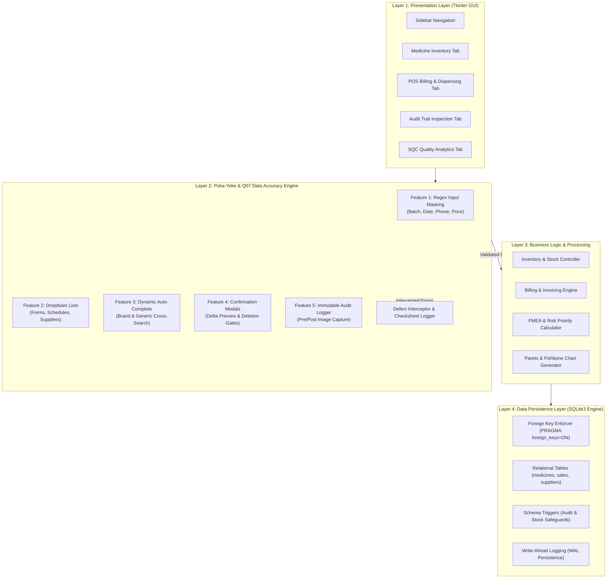
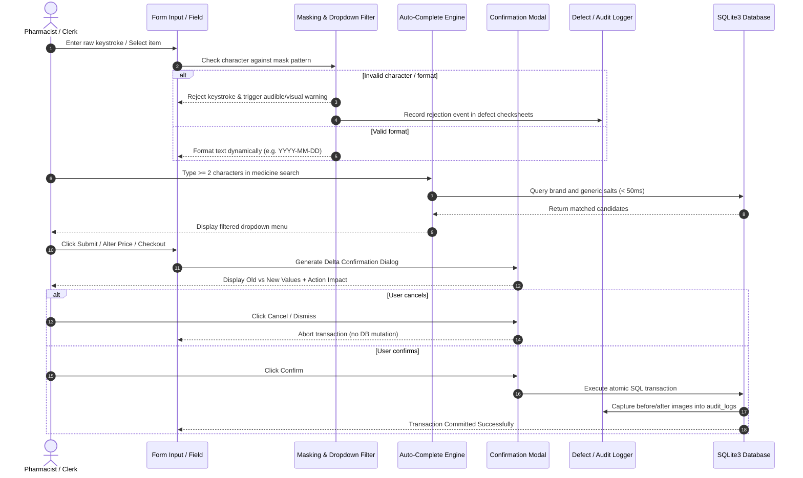

# System Architecture & Flowchart Specification
## Pharmacy Management System - [Q07: Improve Data Accuracy]
### Course: BBAT104 - Fundamentals of TQM | Academic Session: 2026–27
**Author:** Anmol Joshi (Roll No: 2410302004, Branch: CSE-B)

---

## 1. Architectural Style & Layered Model

The Pharmacy Management System is engineered using a **Layered Model-View-Controller (MVC)** pattern infused with an active **Poka-Yoke Quality Assurance Layer**. This architecture ensures that no user input reaches the database persistence layer without passing through multi-stage sanitization, constraint validation, and audit tracking.

---

## 2. Poka-Yoke Data Validation Pipeline

The operational workflow for data entry explicitly enforces zero defect propagation (Deming Point 3: Cease dependence on mass inspection; build quality into the process):

---

## 3. High-Level Component Interactions

| Subsystem Component | Primary Responsibility | TQM Principle Alignment |
| :--- | :--- | :--- |
| **`app.py`** | Central Tkinter application orchestrating tabs and UI state | Customer Focus & Ergonomics |
| **`widgets.py`** | Custom input-masked entry widgets, dropdowns, and modal dialogs | Poka-Yoke (Mistake Proofing) |
| **`database.py`** | SQLite relational initialization, foreign keys, and atomic commits | Fact-Based Quality & Standardization |
| **`models.py`** | Entity models with built-in validation rules and business invariants | Process Integrity & Defect Prevention |
| **`defect_logger.py`**| Real-time capture of intercepted errors for checksheet aggregation | Empirical Quality Control (SQC) |
| **`pareto.py`** | Pareto 80/20 frequency analysis and cumulative curve visualization | Juran's Vital Few vs. Trivial Many |
| **`fishbone.py`** | Ishikawa cause-and-effect diagram generator across 6M categories | Root Cause Analysis (Kaizen) |
| **`fmea.py`** | Risk Priority Number (RPN) computation engine ($S \times O \times D$) | Preventive Risk Management (FMEA) |

---

## 4. Hardware and Runtime Environment Flow
1. **Application Launch:** Initializes local SQLite engine (`pharmacy.db`), executes `CREATE TABLE IF NOT EXISTS`, and checks trigger definitions.
2. **Seed Verification:** Populates essential baseline categories, verified suppliers, and benchmark pharmaceuticals if the database is newly created.
3. **Event Loop Execution:** Binds keyboard shortcuts, input validation hooks, and starts Tkinter desktop main loop.
